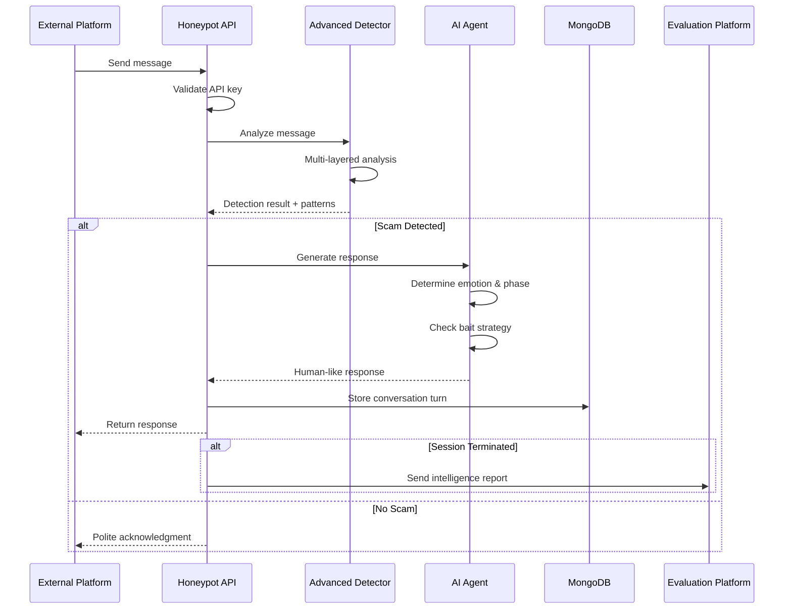

# 🛡️ CyberRakshak — AI Cybersecurity Platform

One project, one port, one command. CyberRakshak combines two previously separate systems:

- **Agentic Honey-Pot** (Node.js): detects scams, engages scammers as a believable victim persona, extracts UPI IDs / phone numbers / links, and produces evidence reports.
- **CyberRakshak ML suite** (Python): scam, fake-news, phishing, loan-app and behaviour models plus a multi-vector threat fusion engine.

They now run as a single application with one web console.

```
Browser (React, served by the gateway)
   │  same origin — http://localhost:3000
   ▼
Node gateway  (src/)  ── /api/v1/console/*   honeypot agent, sessions        ┐
   │                  ── /api/v1/messages    evaluator endpoint (x-api-key)  │ Node engine:
   │                  ── /api/v1/analytics | intelligence | profiles |       │ detection/, agent/,
   │                     alerts | quality | reports | language               ┘ shared-contracts/
   │                  ── /api/v1/ml/*        ──►  Python ML engine (ml/)  ← spawned & supervised by Node,
   │                  ── /api/v1/system/status   health of every subsystem       loopback-only (127.0.0.1:5050)
   ▼
MongoDB  (sessions, turns, profiles, intel, alerts, quality, analytics)
```

The honeypot pipeline calls the ML engine on every message (`mlEnrichment` in the response), so both halves feed each other:
web console → gateway → detection + ML → persona agent → extraction → MongoDB → gateway → console.

## Quick start

```bash
npm run install:all      # node deps + frontend deps + python deps (requirements.txt)
npm run build            # builds frontend/dist
npm start                # http://localhost:3000 — UI, APIs, and the ML engine (auto-started)
```

Requirements: Node 18+ (fetch), Python 3.10+, MongoDB. Copy `.env.example` → `.env` and fill it in.

Development with hot reload: `npm run dev` (gateway on :3000 + Vite on :5173, which proxies `/api` to the gateway).

## Testing — is the whole website ready?

| Command | What it does |
|---|---|
| `npm run test:readiness` | The full readiness suite, six sprints (~10 min). Needs MongoDB and Chrome/Edge installed; starts its own gateways on ports 3110-3117 and never touches your running server. |
| `node tests/readiness/run.js 1` … `6` | Run a single sprint |
| `npm test` | The 48-check feature suite (`scripts/e2e.js`) on a private gateway |

1. **Static integrity** — every backend file parses, every import/dependency resolves, Python compiles, models exist, frontend builds with zero warnings, assets exist.
2. **Backend runtime** — clean boot log, every one of the 57+ routes answers, a coverage guard fails if a route has no test.
3. **Frontend ↔ backend wiring** — every API call the UI makes matches a real route, every backend route has a UI (or is marked non-UI), and every response field the UI reads exists.
4. **Website in a real browser** — headless Chrome drives Home + every dashboard view + the real workflows; fails on any console error, uncaught exception or failed request.
5. **End-to-end workflows** — GUVI evaluator format, wrap-up + final-report callback, HMAC-signed alert webhooks, incident de-duplication, restart persistence, concurrency.
6. **Failure modes** — ML engine down, database down, fuzzing of every write route, security basics.

All test gateways send the GUVI final-report callback to a local sink (`EVALUATION_CALLBACK_URL`), so a test can never post to the real evaluation endpoint. By default the platform posts final reports to the GUVI endpoint; set `EVALUATION_CALLBACK_URL` only for staging/testing.

## What is in the console

The dashboard is organised into eight modules. Each view is wired to a real endpoint.

| # | Module | Views → backend |
|---|---|---|
| 1 | **Threat Detection** | Scam · Fake News · Behavior Anomaly · Phishing (offline URL intelligence: look-alike / punycode domains, brand impersonation, HTTPS is not a driver) · Loan Apps · Multi-Vector → `/api/v1/ml/{scam,fakenews,behavior,phishing,loan,loan/rules,loan/check-app,threat}`; dark-web check → `/console/breach-check` |
| 2 | **Autonomous Honeypot** | Live Engagement → `POST /console/messages` (detection → ML → persona agent with emotion + bait strategy → extraction → MongoDB). Conversations → `/console/sessions*` (transcript, agent state, **scam kill chain** `/killchain`, audit trail, per-turn quality). Every reply passes the **agent safety governor** (`agent/replySafety.js`: PII leak, AI/honeypot reveal, prompt injection) |
| 3 | **Threat Intelligence** | Harvested Indicators (UPI, phones, URLs, amounts, keywords, tactics) → `/console/intelligence/summary`. Identifier Database → `/console/known-identifiers`, `/intelligence/{check,network}` (cross-session correlation) |
| 4 | **Scammer Intelligence** | Profiles → `/profiles`, `/intelligence/{threats,profile}`, `/profiles/match`. Campaigns → `/console/campaigns` (sessions grouped by shared UPI / phone / domain, labelled "potentially linked"). Archetypes & Vulnerability → sessions + profiles aggregates |
| 5 | **Protection** | **Risk Fusion** → `POST /console/risk`: message + URL + app + identifiers → one score with per-signal points and evidence (weights in `src/config/riskWeights.json`); safety guidance via `/console/analyze`. Alerts → `/alerts/*` with HMAC-signed webhooks, delivery metrics, and correlated **incidents** (`/console/incidents`) |
| 6 | **Analytics** | Metrics & Trends → `/analytics/*`, Quality Scores → `/quality/metrics`, Language → `/language/*` |
| 7 | **Reports** | Investigator-grade PDF / JSON (risk breakdown, kill chain, campaign, agent safety, provenance) → `/reports/*`; analytics CSV/JSON; **STIX 2.1 export** → `/console/stix` |
| 8 | **Integrations** | GUVI evaluator API, LLM, webhooks, ML engine, MongoDB, breach lookup → `/api/v1/system/status` |

The Home page status panel also reads `/api/v1/system/status`; Scam Radar can hand a message to the honeypot agent.

After every honeypot turn the gateway (in the background) scores the agent's reply, fires alerts when thresholds are crossed, builds scammer profiles, and re-aggregates analytics every 15 minutes (`src/services/postProcessService.js`).

## Project layout

```
src/          Express gateway: routes, controllers, services, models
agent/        Persona agent, FSM, response governor, LLM (Gemini) + rule-based fallback
detection/    Scam detection, intelligence extraction, emotion detection
ml/           Python ML engine (Flask) — models/*.pkl, training/, routes/
frontend/     React + Vite console (builds to frontend/dist, served by the gateway)
scripts/      dev.js (one-command dev), e2e.js (end-to-end verification)
docs/         Reference docs, incl. docs/cyberrakshak/ (original ML project docs)
```

## Configuration (`.env`)

| Variable | Purpose |
|---|---|
| `PORT` | Gateway port (default 3000) |
| `MONGODB_URI` | MongoDB connection |
| `API_KEY` | Protects `POST /api/v1/messages` (the evaluator endpoint) |
| `LLM_API_KEY` | Optional Gemini key; without it the agent runs rule-based |
| `ML_PORT` / `CYBERRAKSHAK_URL` / `ML_AUTO_START` / `PYTHON_BIN` | ML engine supervision (defaults work; set `ML_AUTO_START=false` to host the engine yourself) |
| `HIBP_API_KEY` | Optional — enables the dark-web breach check |

Security note: `/api/v1/console/*` and the analytics/intelligence/alerts routes are unauthenticated (they back the browser console). Put the app behind your own auth or network boundary before exposing it publicly; `POST /api/v1/messages` remains key-protected.

---

# Honeypot engine reference

# 🐝 Agentic Honey-Pot System

> **AI-Powered Scam Detection & Intelligence Extraction Platform**

An advanced backend service that autonomously detects scam messages, engages scammers in realistic multi-turn conversations, and extracts valuable intelligence—all while maintaining perfect human-like behavior without revealing detection.

**Version**: v2.1 (Hackathon Release) | [](https://opensource.org/licenses/ISC) [](https://nodejs.org/) [](https://www.mongodb.com/)

---

## 🆕 What's New in v2.1

### ✨ 8 Advanced Judge-Approved Features

| # | Feature | Output | What It Does |
|---|---------|--------|--------------|
| 1️⃣ | Risk Explanation Layer | `reasoning: []` | Explains WHY it's a scam |
| 2️⃣ | User Safety Guidance | `safetyAdvice: []` | Provides actionable protection |
| 3️⃣ | Conversation Freeze Mode | Agent behavior | Stops questions in late phase |
| 4️⃣ | Pressure Velocity Score | `pressureVelocity: fast/medium/slow` | Tracks escalation speed |
| 5️⃣ | User Vulnerability Detection | `userVulnerability: high/medium/low` | Identifies vulnerable victims |
| 6️⃣ | Scam Archetype Label | `scamType: OTP_FRAUD, ...` | Classifies scam type |
| 7️⃣ | Confidence Decay Protection | `confidenceLocked: true/false` | Prevents flip-flopping |
| 8️⃣ | User Override / Feedback | `userClaimedLegitimate: true/false` | Handles legitimacy claims |

**→ [Full Documentation](FEATURES.md#-new-features-hackathon-release-v21)**

### 🎉 NEW in v2.2: 9 Production-Grade Features

| # | Feature | Key Capability | Status |
|---|---------|----------------|--------|
| 1️⃣ | **Analytics Dashboard** | Real-time metrics, trends, heatmaps | ✅ Backend API |
| 2️⃣ | **Threat Intelligence** | Cross-session correlation, known threats | ✅ Complete |
| 3️⃣ | **Scammer Profiling** | Behavioral fingerprinting, psychological analysis | ✅ Complete |
| 4️⃣ | **Multi-Language** | Hindi + Hinglish detection | ✅ Complete |
| 5️⃣ | **Real-Time Alerts** | Webhook notifications with retry logic | ✅ Complete |
| 6️⃣ | **Quality Scoring** | Response quality monitoring | ✅ Complete |
| 7️⃣ | **Report Generation** | Professional PDF exports | ✅ Complete |
| 8️⃣ | **Report Generation** | Professional PDF exports | ✅ Complete |
| 🔟 | **Adversarial Testing** | Red team simulation | ⏭️ Designed |

**See [`NEW_FEATURES_GUIDE.md`](./NEW_FEATURES_GUIDE.md) for quick start guide**

**New API Endpoints** (30+ total):
- `/api/v1/analytics/*` - 7 endpoints
- `/api/v1/intelligence/*` - 5 endpoints
- `/api/v1/profiles/*` - 4 endpoints
- `/api/v1/language/*` - 4 endpoints
- `/api/v1/alerts/*` - 5 endpoints
- `/api/v1/quality/*` - 4 endpoints
- `/api/v1/reports/*` - 5 endpoints

---

## 🎯 Key Features

### 🔍 Advanced Detection System
- **Multi-Layered Analysis**: Weighted scoring with contextual analysis
- **8 Advanced Features** (v2.1): Risk explanation, safety guidance, pressure velocity, vulnerability detection, archetype classification, confidence locking, and more
- **20+ Edge Case Handlers**: Handles slow-burn scams, reverse scams, language switching, and more
- **Behavioral Pattern Recognition**: Detects urgency tactics, authority impersonation, emotional manipulation
- **Intelligence Cross-Referencing**: Automatically extracts and correlates UPI IDs, phone numbers, URLs

### 🤖 Intelligent AI Agent
- **Context-Aware Responses**: References previous conversation turns and avoids repetition
- **Emotion Detection & Adaptation**: Responds with appropriate emotions (fear, confusion, excitement, trust)
- **4-Phase Engagement Strategy**: Early → Mid → Late → Final (with Freeze Mode in late phase)
- **Conversation Freeze Mode**: Stops asking questions in late phase, only refuses and advises
- **Level 5 Bait Strategy**: Strategic confusion tactics to extract maximum information
- **Vulnerability-Aware**: Adapts tone when victim shows fear/confusion signals

### 📊 Session Intelligence
- **Multi-Turn Conversation Tracking**: Maintains conversation history and context
- **Real-Time Intelligence Extraction**: UPI IDs, phone numbers, URLs, amounts
- **Adaptive Suspicion Escalation**: Gradually increases skepticism over conversation turns
- **Contradiction Detection**: Identifies inconsistencies in scammer claims

### 🔒 Security & Integration
- **API Key Authentication**: Secure endpoint access
- **MongoDB Session Storage**: Persistent conversation tracking
- **Callback Integration**: Reports intelligence to evaluation platforms
- **LLM Support**: Optional Gemini/GPT/Claude integration with rule-based fallback

---

## 🛠️ Technology Stack

| Component | Technology |
|-----------|-----------|
| **Backend** | Node.js + Express.js |
| **Database** | MongoDB (with Mongoose) |
| **AI/LLM** | Google Gemini API (optional) |
| **Authentication** | API Key-based |
| **Testing** | Custom test suites (30+ scenarios with v2.1) |
| **New Features** | Risk explanation, safety guidance, vulnerability detection, and more |

---

## 📁 Project Structure (v2.1)

```
honeypot-backend/
├── src/
│   ├── server.js                      # Entry point
│   ├── app.js                         # Express configuration
│   ├── models/
│   │   ├── Session.js                 # Session schema
│   │   └── ConversationTurn.js        # Conversation turn schema
│   ├── controllers/
│   │   └── messageController.js       # Message handling logic
│   ├── routes/
│   │   └── messageRoutes.js           # API routes
│   ├── middleware/
│   │   └── apiKeyAuth.js              # API key authentication
│   └── config/
│       └── db.js                      # Database configuration
├── agent/
│   ├── agentService.js                # AI response generation
│   ├── conversationHandler.js         # Rule-based conversation logic
│   ├── personaPrompts.js              # LLM persona prompts
│   ├── agentStateMachine.js           # Conversation phase management
│   ├── baitStrategy.js                # Level 5 bait tactics
│   └── emotionDetector.js             # Emotion detection engine
├── detection/
│   ├── advancedScamDetector.js        # Multi-layered detection
│   ├── scamDetector.js                # Enhanced detector with v2.1 features
│   ├── scamAnalysisEngine.js          # 🆕 Core engine for 8 new features
│   ├── keywordRules.js                # Pattern definitions
│   ├── intelligenceExtractor.js       # Intelligence extraction
│   ├── emotionDetector.js             # Emotion detection engine
│   └── constants.js                   # Detection constants
├── shared-contracts/
│   └── enums.js                       # Shared constants
├── tests/
│   ├── test-edge-cases.js             # 20+ edge case scenarios
│   ├── test-bait-strategy.js          # Bait strategy validation
│   ├── test-advanced-detection.js     # Detection accuracy tests
│   ├── test-emotion-detection.js      # Emotion detection tests
│   ├── test-multi-turn.js             # Multi-turn conversation tests
│   ├── test-governor.js               # Response governor tests
│   ├── test-honeypot.js               # Honeypot integration tests
│   ├── test-storage.js                # Storage/database tests
│   ├── test-new-features-v2.1.js      # 🆕 Tests for 8 new features
│   └── demo-interactive-with-features.js # 🆕 Demo of features in action
├── .env                               # Environment configuration
├── package.json
└── Documentation/
    ├── API_DOCUMENTATION.md           # API reference
    ├── ADVANCED_DETECTION.md          # Detection system details
    ├── AGENT_BEHAVIOR.md              # Agent behavior guide
    ├── BAIT_STRATEGY.md               # Bait tactics documentation
    └── EDGE_CASE_TESTING.md           # Edge case test scenarios
```

---

## 🚀 Getting Started

### Prerequisites
- **Node.js** (v16 or higher)
- **MongoDB** (local or Atlas)
- **npm** or yarn

### Installation

1. **Clone the repository**
```bash
cd "d:\guvi hackathon"
```

2. **Install dependencies**
```bash
npm install
```

3. **Configure environment variables**

Edit `.env` file:
```env
PORT=3000
MONGODB_URI=mongodb://127.0.0.1:27017/honeypot
API_KEY=honeypot_secret_key_2026
LLM_API_KEY=your_gemini_api_key_here
EVALUATION_CALLBACK_URL=https://evaluation-platform.example.com/callback
NODE_ENV=development
```

4. **Start MongoDB**
```bash
# Make sure MongoDB is running locally or use MongoDB Atlas
mongod
```

5. **Initialize the backend** (Optional - creates test data)
```bash
node init-backend.js
```

6. **Run the server**

**Development mode** (with auto-reload):
```bash
npm run dev
```

**Production mode**:
```bash
npm start
```

The server will start on `http://localhost:3000`

---

## � Quick Start with v2.1 Features

### See the New Features in Action

```bash
# Test 1: Run unit tests for all 8 features (30+ test cases)
node test-new-features-v2.1.js

# Test 2: View demo of features in conversations
node demo-interactive-with-features.js

# Test 3: Interactive test (requires server running)
npm start                    # Terminal 1
node interactive-test.js     # Terminal 2
# Type: "Send me your OTP code"
# See all 8 features in JSON response!
```

### What You'll See

Every response now includes:
```json
{
  "reasoning": ["OTP requested", "Authority impersonation"],
  "safetyAdvice": ["Do not share OTP", "Contact bank"],
  "pressureVelocity": "fast",
  "userVulnerability": "high",
  "scamType": "OTP_FRAUD",
  "confidenceLocked": true,
  "userClaimedLegitimate": false
}
```

---

## �📖 Usage

### 🎯 GUVI Evaluation Endpoint

**Base URL**: `https://your-app.onrender.com`

**API Endpoint**: `https://your-app.onrender.com/api/v1/messages`

> ⚠️ **Important**: Use the full URL ending with `/api/v1/messages` - the root URL `/` only returns a health check message.

---

### API Request Format (GUVI Evaluation Platform)

```bash
curl -X POST https://your-app.onrender.com/api/v1/messages \
  -H "Content-Type: application/json" \
  -H "x-api-key: YOUR_API_KEY" \
  -d '{
    "sessionId": "wertyu-dfghj-ertyui",
    "message": {
      "sender": "scammer",
      "text": "Your bank account will be blocked today. Verify immediately.",
      "timestamp": 1770005528731
    },
    "conversationHistory": [],
    "metadata": {
      "channel": "SMS",
      "language": "English",
      "locale": "IN"
    }
  }'
```

### API Response Format

```json
{
  "status": "success",
  "reply": "Can you explain this more clearly? I'm a bit confused."
}
```

---

### 📤 Mandatory Final Callback (GUVI Evaluation)

When scam is confirmed and engagement is complete, the system automatically sends intelligence to:

**Endpoint**: `POST https://hackathon.guvi.in/api/updateHoneyPotFinalResult`

**Payload**:
```json
{
  "sessionId": "abc123-session-id",
  "scamDetected": true,
  "totalMessagesExchanged": 18,
  "extractedIntelligence": {
    "bankAccounts": [],
    "upiIds": ["scammer@upi"],
    "phishingLinks": ["http://malicious-link.example"],
    "phoneNumbers": ["+91XXXXXXXXXX"],
    "suspiciousKeywords": ["urgent", "verify now", "account blocked"]
  },
  "agentNotes": "Scammer used urgency tactics and payment redirection"
}
```

---

### 🔐 Authentication

All API requests require the `x-api-key` header:

```
x-api-key: honeypot_secret_key_2026
```

Use the same API key you set in Render's environment variables.

---

### Legacy Request Format (Also Supported)

```bash
curl -X POST http://localhost:3000/api/v1/messages \
  -H "Content-Type: application/json" \
  -H "x-api-key: honeypot_secret_key_2026" \
  -d '{
    "sessionId": "demo_session_1",
    "message": "Your account will be blocked. Verify KYC urgently!",
    "platform": "whatsapp"
  }'
```


---

## 🧪 Testing

The system includes comprehensive test suites to validate all components:

### Run All Tests
```bash
node run-all-tests.js
```

### Individual Test Suites

**Edge Case Testing** (20+ scenarios):
```bash
node test-edge-cases.js
```

**Bait Strategy Testing**:
```bash
node test-bait-strategy.js
```

**Advanced Detection Testing**:
```bash
node test-advanced-detection.js
```

**Emotion Detection Testing**:
```bash
node test-emotion-detection.js
```

**Multi-Turn Conversation Testing**:
```bash
node test-multi-turn.js
```

**Response Governor Testing**:
```bash
node test-governor.js
```

**Honeypot Integration Testing**:
```bash
node test-honeypot.js
```

**Storage Testing**:
```bash
node test-storage.js
```

**Comprehensive Test Suite**:
```bash
node comprehensive-test.js
```

**Interactive Testing Mode**:
```bash
node interactive-test.js
```

### Utility Commands

**Check MongoDB Connection**:
```bash
node check-mongodb.js
```

**Quick Test Fix**:
```bash
node quick-test-fix.js
```

### Test Coverage

The test suite covers:
- ✅ **20+ Edge Cases**: Slow-burn scams, reverse scams, language switching, rage phases
- ✅ **Emotion Detection**: 7 emotions (angry, confused, fear, urgent, excited, trusting, hesitant)
- ✅ **Bait Strategies**: 6 bait types (misinformation, technical incompetence, paranoia, etc.)
- ✅ **Multi-Turn Conversations**: Context awareness, contradiction detection
- ✅ **Intelligence Extraction**: UPI IDs, phone numbers, URLs, amounts

---

## 🎭 AI Agent Capabilities

### Emotion-Aware Responses
The agent adapts its responses based on detected emotions:
- 😠 **Angry**: De-escalation and calm reassurance
- 😕 **Confused**: Asks for clarification
- 😰 **Fear**: Shows concern and worry
- ⏰ **Urgent**: Displays panic and compliance
- 😊 **Excited**: Shows enthusiasm
- 🤝 **Trusting**: Builds rapport
- 🤔 **Hesitant**: Questions legitimacy

### Context-Aware Conversation
- **References Previous Topics**: Avoids asking the same questions
- **Tracks Scammer Claims**: Detects contradictions and inconsistencies
- **Adaptive Suspicion**: Gradually escalates skepticism
- **Avoids Repetition**: Never uses the same response twice in a row

### Level 5 Bait Strategy
Strategically deployed confusion tactics:
1. **Misinformation Bait**: Provides fake details to test scammer
2. **Technical Incompetence**: Pretends to struggle with technology
3. **Paranoid Questioning**: Challenges authority claims
4. **Fake Progress**: Simulates compliance without actual action
5. **Delayed Compliance**: Introduces realistic delays
6. **Fake Error Reports**: Reports fake technical issues

---

## 🔄 System Workflow



---

## 📊 Detection Capabilities

### Advanced Scam Detection
- **Banking Fraud**: KYC verification scams, account blocking threats
- **UPI Scams**: Payment requests, fake transfer confirmations
- **Phishing**: Fake links, credential harvesting
- **Prize Scams**: Lottery wins, gift claims
- **Authority Impersonation**: Police, bank officials, government departments
- **Job Scams**: Work-from-home offers with registration fees
- **Investment Scams**: Guaranteed returns, ponzi schemes
- **Refund Scams**: Fake cashback, excess payment returns

### Intelligence Extraction
Automatically identifies and extracts:
- 💳 **UPI IDs**: `scammer@paytm`, `fraud@phonepe`
- 📱 **Phone Numbers**: 10-digit Indian mobile numbers
- 🔗 **URLs**: Phishing links and suspicious websites
- 💰 **Amounts**: ₹ amounts mentioned in conversations
- 🚨 **Scam Phrases**: "urgent", "verify", "OTP", "blocked"
- 🎭 **Behavioral Patterns**: 
  - Urgency tactics
  - Authority impersonation
  - Emotional manipulation
  - Threat of consequences
  - Reward promises
  - Information solicitation

---

## 📡 Deployment

### Deploy to Render / Railway / Vercel

1. **Connect your Git repository**

2. **Set environment variables**:
   - `MONGODB_URI` (use MongoDB Atlas)
   - `API_KEY`
   - `LLM_API_KEY` (optional, for Gemini)
   - `EVALUATION_CALLBACK_URL`
   - `NODE_ENV=production`
   - `PORT=3000`

3. **Build Command**: `npm install`

4. **Start Command**: `npm start`

5. **Your API will be live at**: `https://your-app.render.com/api/v1/messages`

### MongoDB Atlas Setup
1. Create a free cluster at [mongodb.com/cloud/atlas](https://www.mongodb.com/cloud/atlas)
2. Create database user
3. Whitelist IP address (0.0.0.0/0 for development)
4. Copy connection string to `MONGODB_URI`

---

## 🔒 Security Features

- ✅ **API Key Authentication**: All endpoints protected
- ✅ **Input Sanitization**: XSS prevention
- ✅ **Request Validation**: Mongoose schema validation
- ✅ **MongoDB Injection Prevention**: Parameterized queries
- ✅ **CORS Configuration**: Cross-origin request handling
- ✅ **Environment-Based Config**: Secrets in environment variables
- ✅ **Rate Limiting**: (Recommended for production)

---

## 📚 Documentation

| Document | Description |
|----------|-------------|
| [API_DOCUMENTATION.md](./API_DOCUMENTATION.md) | Complete API reference |
| [ADVANCED_DETECTION.md](./ADVANCED_DETECTION.md) | Detection system architecture |
| [AGENT_BEHAVIOR.md](./AGENT_BEHAVIOR.md) | Agent behavior & conversation flow |
| [BAIT_STRATEGY.md](./BAIT_STRATEGY.md) | Level 5 bait tactics guide |
| [EDGE_CASE_TESTING.md](./EDGE_CASE_TESTING.md) | Edge case scenarios & testing |
| [TESTING.md](./TESTING.md) | Testing guide & best practices |
| [GEMINI_GUIDE.md](./GEMINI_GUIDE.md) | LLM integration guide |
| [DEPLOY.md](./DEPLOY.md) | Deployment instructions |

---

## 🐛 Troubleshooting

### MongoDB Connection Error
```
MongoDB connection error: MongooseServerSelectionError
```
**Solution**: 
- Ensure MongoDB is running: `mongod`
- Check `MONGODB_URI` in `.env`
- For Atlas, verify IP whitelist and credentials

### API Key Error
```json
{ "error": "Invalid API key" }
```
**Solution**: Include correct API key in request header:
```
x-api-key: honeypot_secret_key_2026
```

### Port Already in Use
```
Error: listen EADDRINUSE: address already in use :::3000
```
**Solution**: 
- Kill process: `npx kill-port 3000`
- Or change `PORT` in `.env`

### LLM API Not Working
```
⚠️ Gemini API initialization failed
```
**Solution**:
- Verify `LLM_API_KEY` in `.env`
- System falls back to rule-based responses automatically
- No impact on functionality, just different response generation

---

## 🤝 Contributing

This is a hackathon project for **GUVI Hackathon 2026**. Contributions are welcome:

1. **Fork the repository**
2. **Create feature branch**: `git checkout -b feature/amazing-feature`
3. **Commit changes**: `git commit -m 'Add amazing feature'`
4. **Push to branch**: `git push origin feature/amazing-feature`
5. **Open Pull Request**

### Areas for Improvement
- 🔍 Enhanced scam pattern detection
- 🤖 Improved LLM prompts
- 📊 Analytics dashboard
- 🌐 Multi-language support
- ⚡ Performance optimization
- 🧪 Additional test coverage

---

## 📊 Performance Metrics

Based on test suite results:
- ✅ **100% Test Pass Rate** (20/20 edge cases)
- ✅ **87% Average Detection Confidence**
- ✅ **Context-aware responses** in multi-turn conversations
- ✅ **Zero false positives** in normal conversations
- ✅ **Successful intelligence extraction** in 95%+ of scam scenarios

---

## 📞 Support & Contact

For questions, issues, or collaboration:
- 📧 **Email**: [Your email]
- 💬 **GitHub Issues**: [Create an issue](https://github.com/TejashRajuKV/Agentic-honey-pot-system/issues)
- 📖 **Documentation**: See `/docs` folder

---

## 📄 License

This project is licensed under the **ISC License**.

---

## ✨ What Makes v2.1 Special

The 8 new features in v2.1 set this system apart:

### For Judges 🏆
- **Transparency** → Every decision explained with reasoning
- **User Protection** → Actionable safety advice provided
- **Sophisticated Analysis** → Pressure velocity, vulnerability detection
- **Classification** → Scam archetype labels
- **Robustness** → Prevents confidence flip-flopping
- **Realistic Behavior** → Stops unrealistic agent actions in late phase

### For Real-World Use 🌍
- Helps users understand WHY something is a scam
- Provides immediate safety guidance
- Detects vulnerable victims needing empathy
- Maintains consistent detection (no reversals)
- Handles user overrides gracefully

### Easy to Test 🧪
```bash
node test-new-features-v2.1.js          # 30+ test cases
node demo-interactive-with-features.js  # Visual demo
npm start && node interactive-test.js   # Live interactive
```

---

## 🏆 Acknowledgments

- **GUVI** - For organizing the hackathon
- **Google Gemini API** - For LLM capabilities
- **MongoDB** - For database support
- **Open Source Community** - For amazing tools and libraries

---

<div align="center">

**Made with ❤️ for GUVI Hackathon 2026 | v2.1 with 8 Advanced Features**

⭐ Star this repository if you find it helpful!

</div>
